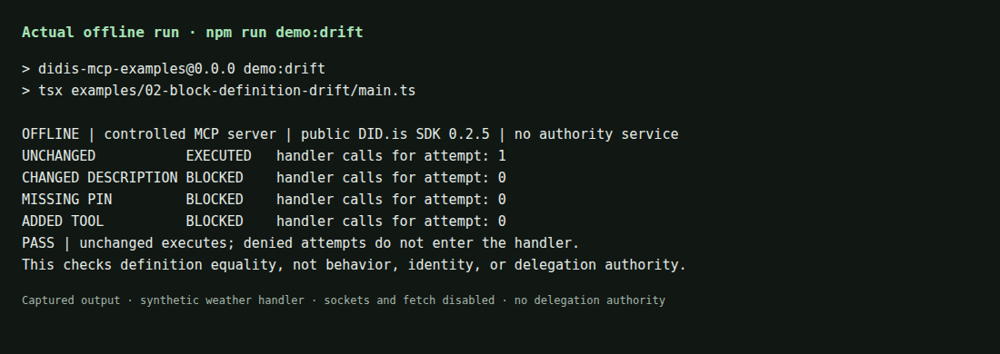

# See a definition change stop a call

This is an **actual offline execution**, not a simulated result or a live server inspection. The public DID.is SDK computes fingerprints; the official MCP SDK connects a controlled client and server in memory. The synthetic weather handler only increments a counter.



The PNG is a **static rendering of captured terminal output**, not a screen recording. The short [terminal recording](demo/drift.cast) preserves the actual PTY output and event timing in asciicast v2 format. View the [plain-text transcript](demo/drift.txt) without installing anything, or replay a downloaded recording with the optional [asciinema player](https://docs.asciinema.org/manual/cli/usage/): `asciinema play drift.cast`. No hosted player or upload is needed.

## Reproduce the run

From the repository root, with Node.js 22.19+ and npm:

```sh
npm ci
npm run demo:drift
```

Installation uses the public npm registry. The demo itself needs no network, account, API key, or LLM key. The committed recording was additionally run with the existing network-denial test preload; see [runtime versions, source commit, capture time, exit code and hashes](demo/provenance.json).

## Follow three steps in the source

1. **Review and approve a baseline.** [`reviewed.json`](../fixtures/tools/reviewed.json) is a committed synthetic definition, explicitly approved in [`main.ts`](../examples/02-block-definition-drift/main.ts). It is not automatically approved from a remote first observation.
2. **Call the unchanged tool.** [`boundary.ts`](../examples/02-block-definition-drift/boundary.ts) reads the current inventory, compares SDK pins and the inventory hash, and only then calls `client.callTool`. That attempt enters the handler **once**.
3. **Change only the description and call again.** [`changed-description.json`](../fixtures/tools/changed-description.json) keeps the tool name and schema. The same approved baseline now rejects the attempt with `TOOL_DRIFT`. The handler counter stays at one: **zero entries for the changed attempt**. The command also asserts zero entries for a missing pin and an added tool.

The demo exits **0** when its expected executions and denials all match. An unexpected handler entry fails the command. Do not copy a printed `PASS` into your own gate; copy the checked execution boundary, keep the raw client private, and adapt argument validation and business authorization to your application. Never automatically replace pins after a mismatch.

## Choose your next step

- [Copy the local execution boundary](../examples/02-block-definition-drift/): definition equality only, not the full SDK guard or delegation authorization.
- [Inspect an owned public HTTPS server](../examples/01-inspect-public-server/): offline fixture first; opt in explicitly to a hosted live inspection. Inspection contacts the target to list definitions, not execute its tools.
- [Connect your MCP client to DID.is](../examples/00-connect-didis/): use existing lookup tools. Connecting this server does not protect your other tools.
- [Add delegation authorization with the full SDK guard](https://docs.did.is/build/guard-tools/).

Definition equality does not establish server identity, unchanged behavior, or freedom from prompt injection. The sample only controls calls routed through its boundary; it is not host-wide protection. [Read the limitations](LIMITATIONS.md).
